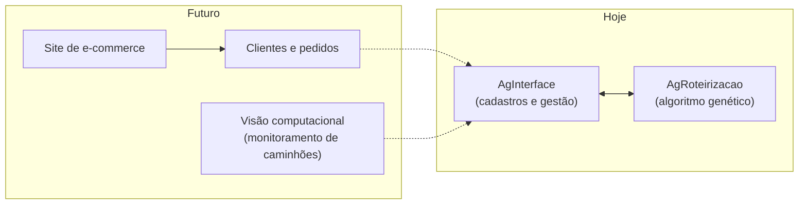
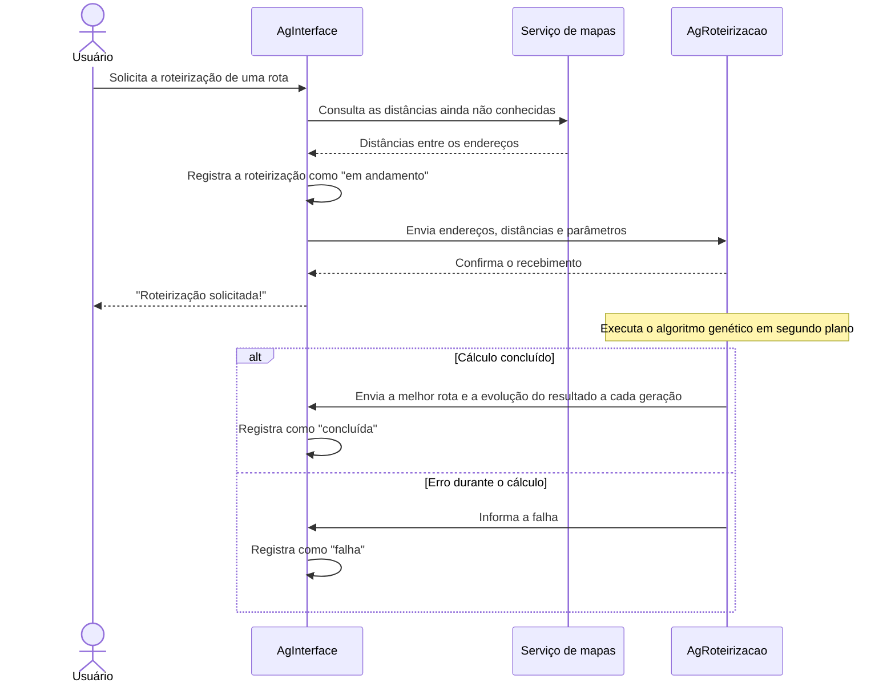

# AgInterface

Sistema administrativo para cadastro de endereços e rotas e para gestão das roteirizações.

> [!NOTE]
> Projeto pessoal, em desenvolvimento. O escopo ainda **não está completo**: o sistema está sendo construído em etapas, e cada etapa representa um novo cenário ou restrição do mundo real.

## Sobre o projeto

O **AgInterface** é a parte administrativa da solução. Nele são cadastrados os endereços e as rotas, e é por ele que se solicita o cálculo da melhor ordem de visita. O sistema guarda o andamento e o resultado de cada roteirização.

Ele não funciona sozinho. Faz parte de uma solução formada por dois projetos que se comunicam:

| Projeto | Papel |
|---|---|
| **AgInterface** (este repositório) | Sistema administrativo: cadastra endereços e rotas, solicita a roteirização e guarda o resultado |
| **[AgRoteirizacao](https://github.com/joaof99/algoritmo-genetico-roteirizacao)** | Motor de cálculo: recebe a rota, executa o algoritmo genético e devolve a melhor ordem de visita |

## O problema que ele resolve

Otimizar uma rota exige muito mais do que o cálculo em si. Antes, é preciso saber **onde** fica cada endereço e **qual a distância real** entre eles. Depois, é preciso **guardar** o resultado e acompanhar se o cálculo terminou bem.

O AgInterface cuida dessa parte:

- **Cadastro de endereços com localização automática:** a partir do endereço informado, o sistema obtém a latitude e a longitude.
- **Distâncias reais entre os endereços:** são consultadas em um serviço de mapas e reaproveitadas nas roteirizações seguintes, evitando consultas repetidas.
- **Cadastro de rotas:** cada rota agrupa os endereços que precisam ser visitados.
- **Solicitação e acompanhamento das roteirizações:** cada pedido fica registrado com seus parâmetros, sua situação (em andamento, concluída ou com falha) e, ao final, a melhor ordem de visita encontrada.

## Relevância

- **Impacto direto no custo das empresas.** O transporte está entre as maiores despesas de qualquer operação que entrega ou coleta mercadorias. No e-commerce, a etapa final da entrega, até a porta do cliente, costuma ser a mais cara de toda a cadeia. Uma rota mais curta reduz combustível, horas de trabalho e manutenção dos veículos todos os dias, em cada entrega.
- **Benefício ambiental.** Menos quilômetros rodados significam menos emissão de poluentes e menos veículos ocupando as ruas.
- **Dados confiáveis para a otimização.** O resultado de uma roteirização só é bom se os dados de entrada forem bons. Endereços localizados com precisão e distâncias reais de trajeto, e não em linha reta, fazem com que a rota calculada corresponda ao que o motorista vai encontrar na rua.
- **Economia no uso de serviços externos.** Como as distâncias já consultadas são reaproveitadas, o custo e o tempo de consulta ao serviço de mapas diminuem à medida que o cadastro cresce.
- **Histórico para decisões melhores.** Cada roteirização fica registrada com seus parâmetros, seu resultado e a evolução do cálculo, o que permite comparar execuções e entender o quanto a otimização trouxe de ganho.

## Visão de longo prazo

O objetivo final é **simular uma empresa de e-commerce completa**, com as regras e restrições de uma operação real. A logística é a primeira parte a ser construída.

Entre os planos para o futuro (distante) estão:

- um **site de e-commerce**, com clientes, pedidos e endereços de entrega;
- roteirização das entregas a partir dos pedidos gerados na simulação;
- **visão computacional** para o monitoramento dos caminhões;
- novas restrições do mundo real na roteirização, como capacidade dos veículos, janelas de horário e múltiplos veículos.



## Como os dois projetos se comunicam

A comunicação é **assíncrona**. O cálculo pode demorar, então o AgInterface não fica esperando: ele faz o pedido, recebe a confirmação na hora e o resultado chega depois.



## Tecnologias

- Java 21
- Spring Boot
- Vaadin (interface web)
- PostgreSQL
- Flyway (versionamento do banco de dados)
- LocationIQ (localização de endereços e distâncias)
- JUnit 5, Mockito e Karibu Testing (testes)

## Como executar

Pré-requisitos: Java 21, Maven, PostgreSQL e uma chave de acesso da [LocationIQ](https://locationiq.com/).

1. Crie um banco de dados vazio no PostgreSQL. As tabelas são criadas automaticamente na primeira execução.
2. Defina as variáveis de ambiente:

   | Variável | Descrição |
   |---|---|
   | `POSTGRES_DBNAME` | Nome do banco de dados |
   | `POSTGRES_USERNAME` | Usuário do banco |
   | `POSTGRES_PASSWORD` | Senha do banco |
   | `IQ_API` | Chave de acesso da LocationIQ |
   | `REST_CLIENT_BASE_URL` | Endereço do AgRoteirizacao (opcional, padrão `http://localhost:8081`) |

3. Execute a classe `Application` pela IDE ou rode:

   ```bash
   mvn spring-boot:run
   ```

   O sistema sobe em `http://localhost:8080`.
4. Para solicitar roteirizações, o [AgRoteirizacao](https://github.com/joaof99/algoritmo-genetico-roteirizacao) também precisa estar em execução, pois é ele que calcula as rotas.

Para rodar os testes:

```bash
mvn test
```

## Evolução da arquitetura (em análise)

A comunicação entre os projetos foi pensada para crescer junto com a simulação. As tecnologias abaixo estão **em fase de estudo**, para avaliar se e como elas podem resolver ou refinar o que já existe à medida que o sistema ganhar escala:

| Tecnologia | O que está sendo avaliado |
|---|---|
| **RabbitMQ** | Troca de pedidos e resultados de roteirização por filas de mensagens, com entrega garantida e possibilidade de várias instâncias do motor de cálculo trabalhando em paralelo |
| **Padrão Transactional Outbox** | Garantia de que o registro da roteirização e o envio do pedido aconteçam sempre juntos |
| **Docker Compose** | Subir todo o ambiente (banco de dados, filas e serviços) com um único comando |
| **Resilience4j** | Políticas de nova tentativa e *circuit breaker* nas integrações com serviços externos |
| **OSRM (Open Source Routing Machine)** | Cálculo local das distâncias reais entre os endereços, com mapas do OpenStreetMap: consultas mais rápidas, sem custo por consulta mesmo em grande volume, suporte a rotas com muitos endereços e perfis de roteamento próprios para caminhões |
| **Kafka** | Fluxos de eventos em grande volume, quando o e-commerce e o monitoramento dos caminhões existirem |

Nenhuma dessas tecnologias foi adotada ainda: a decisão depende dos resultados dessa análise.

## Autor

Desenvolvido por **João** como projeto pessoal de estudo.
